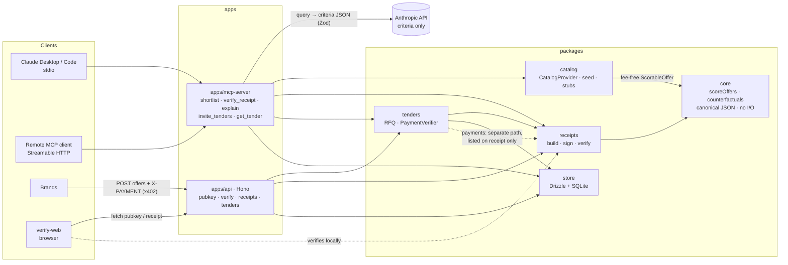

# Shortlisted

An MCP server an AI agent calls **before it buys something**. Every shopping decision comes back with a signed **decision receipt** that anyone can verify.

- A model turns the request into weighted criteria. That is the only thing the model does.
- Plain, deterministic arithmetic ranks the products: same inputs, same output, byte for byte.
- Brands can pay a small flat toll (x402) to be considered. The fee is listed on the receipt and **never reaches the scorer**. That is enforced by the type system and checked by the verifier.

## 60-second quickstart

```bash
npm i -g pnpm          # if you don't have it (Node 20+)
pnpm install
pnpm seed              # creates .data/ (SQLite db + dev signing key) and mock tolls
pnpm demo              # earbuds example end to end; prints the receipt and verifies it
pnpm dev               # API :8787, MCP over HTTP :8788/mcp, verifier page :5173
pnpm test              # 48 tests, including the four non-negotiables
```

Put `ANTHROPIC_API_KEY` in `.env` (`cp .env.example .env`) to have Claude produce the criteria. The repo-root `.env` is loaded by every entry point, including the stdio server Claude Desktop launches, and variables already set in the environment take precedence. Without a key, a deterministic keyword heuristic is used. The receipt records which one ran (`criteria.source`).

## Add it to Claude

**Claude Desktop** (`~/Library/Application Support/Claude/claude_desktop_config.json`). Use absolute paths, because Desktop launches with a minimal `PATH`:

```json
{
  "mcpServers": {
    "shortlisted": {
      "command": "/opt/homebrew/bin/node",
      "args": [
        "/ABSOLUTE/PATH/TO/shortlisted/node_modules/tsx/dist/cli.mjs",
        "/ABSOLUTE/PATH/TO/shortlisted/apps/mcp-server/src/stdio.ts"
      ],
      "env": { "ANTHROPIC_API_KEY": "sk-ant-..." }
    }
  }
}
```

Replace `/opt/homebrew/bin/node` with the output of `which node`. Restart Claude Desktop, then ask: *"wireless earbuds under $100 with good battery life"*.

**Claude Code:**

```bash
claude mcp add shortlisted -- node "$PWD/node_modules/tsx/dist/cli.mjs" "$PWD/apps/mcp-server/src/stdio.ts"
```

**Remote (Streamable HTTP):** run `pnpm dev` (or `pnpm --filter @shortlisted/mcp-server dev:http`) and point a client at `http://localhost:8788/mcp`. If you set `SHORTLISTED_MCP_TOKEN`, send it as a Bearer token.

The stdio server, the HTTP MCP server and the API share one SQLite file and one signing key in `.data/`. So a receipt made in Claude can be fetched from `GET /receipts/:id` and opened in the verifier at `http://localhost:5173/?id=rct_…`.

## Tools

| Tool | What it does |
|---|---|
| `shortlist(query, budget?, constraints?, category?, weights?)` | Query → criteria (from the LLM, or `weights` chosen by the calling agent and recorded as `client`; either way checked against the category schema) → hard filters → deterministic scoring → signed receipt. |
| `verify_receipt(receipt_id | receipt, public_key?)` | Pass `receipt_id` for receipts this server issued (an agent retyping the JSON changes bytes). Signature, content hash, canonical inputs, and a full re-run of the scorer and counterfactuals. Returns `VALID` / `INVALID` with each check. |
| `explain(receipt_id, new_weights)` | Re-scores the receipt's exact signed inputs with other weights and shows what moves. This is a what-if; it produces no new receipt. |
| `invite_tenders(spec, deadline_minutes)` | Opens a request for quote. Criteria are fixed at open, and brands submit over HTTP behind the x402 toll. |
| `get_tender(tender_id)` | Status. After the deadline it closes, scores with the same scorer, and returns the receipt. |

`constraints` are hard filters written as `"max.<attr>"` / `"min.<attr>"`, e.g. `{"min.anc": 1}`.

## HTTP API (Hono)

| | |
|---|---|
| `GET /.well-known/shortlisted-pubkey` | Issuer Ed25519 public key (hex). |
| `POST /verify` | `{ receipt, public_key? }` or a bare receipt → verification result. |
| `GET /receipts/:id` | A stored receipt. |
| `GET /tenders/:id` | Tender status (closes it if past deadline). |
| `POST /tenders/:id/offers` | Brand offer. With no valid `X-PAYMENT` header → **402** with x402 `accepts` requirements. Validation runs before payment, so a malformed offer is never charged. |

```bash
# Mock payments (default): any "mock:<payer>" header pays.
curl -i -X POST localhost:8787/tenders/tnd_…/offers -H 'content-type: application/json' \
  -H 'X-PAYMENT: mock:kestrel' \
  -d '{"brand":"Kestrel","name":"Kestrel One","attributes":{"price":89,"battery_hours":36,"sound_quality":8.5,"comfort":8}}'
```

## Architecture



**Where the AI stops.** The model returns `{category, weights[], budget, min[], max[]}`. `finalizeProposal` drops unknown attributes, normalizes the weights, and takes each attribute's direction (lower or higher is better) from the category schema, never from the model. Everything after that is in `packages/core`, which has no I/O, no clock and no randomness.

**Scoring.** For each criterion, values are min-max normalized across the candidates (flipped when lower is better). If every candidate has the same value, all get 1, and a missing attribute gets 0. The score is the weighted sum, with weights normalized to 1, summed in key order. Ties break by offer id. Scores are shown on a 0–10 scale.

**Counterfactual.** This is the runner-up's price-to-win. Lowering one offer's price can only help it and hurt the others, so "wins at price p" is monotone and a binary search over whole cents is exact. `"Kestrel One wins below $79.98"` means it ranks #1 at $79.97 and not at $79.98. A test checks both sides across random markets.

**Receipt.** It holds the query, the criteria and their source, the exact candidate offers after filtering (sorted by id) and their hash, the filters, rounded scores, who paid and how much, `affected_ranking: false`, the counterfactuals, and the scorer version. The id is a hash of the content, and the timestamp is passed in, so identical inputs give identical bytes. The signature is Ed25519 over `"shortlisted.receipt/v0\n" + canonicalJson(body)`. Verification needs only the receipt and the issuer key. It re-runs the scorer, so even a validly signed receipt whose ranking doesn't follow from its inputs fails.

## The four non-negotiable tests

| Requirement | Where |
|---|---|
| **Fee independence.** Identical offers with different fees get identical scores, and fees can't reach `scoreOffers`. | `packages/core/test/score.test.ts` (type-level `@ts-expect-error` checked by `tsc`, plus a runtime smuggling test), `packages/receipts/test`, `packages/tenders/test` |
| **Determinism.** Same inputs give a byte-identical ranking and receipt body (and signature). | `packages/core/test/score.test.ts`, `packages/receipts/test/receipts.test.ts` |
| **Tamper detection.** Each of the receipt's 100+ leaf fields is mutated in turn; every mutation fails. So do added, removed and reordered entries, and a re-signed receipt with a rigged ranking. | `packages/receipts/test/receipts.test.ts` |
| **Counterfactual correctness.** The computed price flips the ranking one cent below it and not at it. | `packages/core/test/counterfactual.test.ts` |

`pnpm check` runs the typecheck (which enforces the type-level fee test) and then all tests.

## Layout

```
packages/core        pure scoring, counterfactuals, canonical JSON, hashing
packages/receipts    receipt schema (Zod), build, sign, verify (runs in browser too)
packages/catalog     CatalogProvider, category schemas, 40-product seed, Shopify/Google stubs
packages/tenders     tenders, PaymentVerifier (mock + x402 behind SHORTLISTED_PAYMENTS=x402)
packages/store       Drizzle schema + repo on libsql/SQLite, key and db paths
apps/mcp-server      MCP tools, stdio + Streamable HTTP, LLM + heuristic criteria
apps/api             Hono HTTP API
apps/verify-web      paste-a-receipt verifier (Vite), styled like the shortlisted.tech card
scripts/             seed, demo, keygen
```

## Deploying (Vercel + Turso)

`pnpm build:vercel` writes `.vercel/output` in Vercel's Build Output format. It holds the verifier page as static files and one Node function serving the API and `/mcp` on the same origin (`apps/api/src/vercel.ts`). `vercel.json` makes Vercel run that build.

1. **Database (Turso, free tier).** Create a database and a token, put them in `.env` as `SHORTLISTED_DB_URL=libsql://…` and `SHORTLISTED_DB_AUTH_TOKEN=…`, then run `pnpm seed` once to create the tables and mock tolls.
2. **Signing key.** Run `pnpm keygen` and keep the seed somewhere safe. Receipts are verified against this key, so don't rotate it casually.
3. **Vercel.** Import the GitHub repo as a new project (framework preset: Other). Set these environment variables: `SHORTLISTED_ED25519_PRIVATE_KEY`, `SHORTLISTED_DB_URL`, `SHORTLISTED_DB_AUTH_TOKEN`, and `SHORTLISTED_API_URL=https://app.shortlisted.tech`. Add the domain `app.shortlisted.tech`.
4. **Use it.**

```bash
claude mcp add --transport http shortlisted https://app.shortlisted.tech/mcp
```

The verifier page is at `https://app.shortlisted.tech/?id=rct_…`. No Anthropic key is needed on the server: clients pass their own `weights`, and the heuristic covers calls that don't. The hosted endpoint is open by default. Set `SHORTLISTED_MCP_TOKEN` to require a bearer token.

## Notes and next steps

- **Seed data is fictional** (brands, specs, URLs on `.example` domains). Each attribute has a source record, so real adapters can fill the same shape.
- **x402** uses the facilitator `/verify` and `/settle` (v1, `exact` scheme, USDC). It's off by default and isn't covered by tests. Validate it against a testnet facilitator before relying on it.
- **Tolls in catalog shortlists** come from a ledger that `pnpm seed` fills with mock payments. There's no endpoint yet for brands to pay into it; tenders have the full 402 flow.
- **Other hosts:** the API and the HTTP MCP endpoint use web-standard `Request`/`Response` (Hono plus the SDK's web-standard transport), and `core`/`receipts` are pure. For Workers, swap `packages/store/src/paths.ts` (Node `fs`) for env bindings and libsql for D1/Turso. For Fly, run as is with a volume for `.data/`. For Postgres, port `packages/store/src/schema.ts` to `pg-core` and use drizzle-kit migrations.
- **Key management:** `pnpm keygen` prints a seed for `SHORTLISTED_ED25519_PRIVATE_KEY`. Without it, a dev key is created in `.data/`. Rotating the key needs a key-id history in the well-known document (not built yet).
